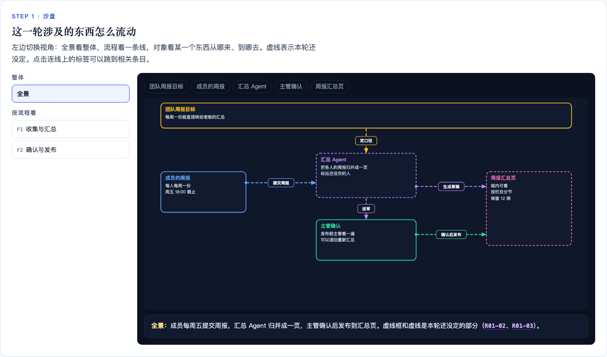
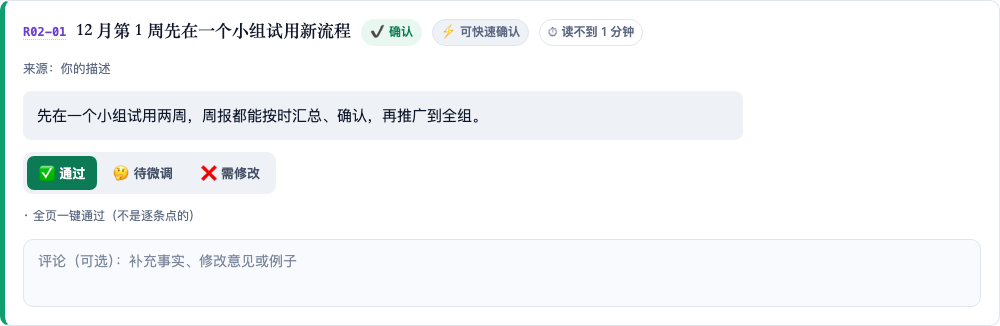

# Interactive Approval Desk

A [Claude Code](https://claude.com/claude-code) skill that turns a proposal, an architecture draft or one round of an iterative review into a single interactive HTML page. The reviewer decides item by item on that page, then exports their decisions as Markdown for the next round.

把方案、架构草稿或某一轮评审做成一个可交互的 HTML 审批页：审批者逐条表态，结果导出为 Markdown，交回 agent 做下一轮。

| Sandbox: how the parts of a round connect | One card: one decision |
|---|---|
|  |  |

*Screenshots of the bundled sample round (a made-up weekly-report process).*

## What a page gives the reviewer

- **A sandbox for structure.** A panorama, one swimlane per flow and one view per object, drawn without overlapping lines or labels.
- **One decision per card.** Four short boxes: what you decide, the recommendation, what you give up and what happens if you disagree. The full reasoning sits in folds on the same card.
- **Every code explained.** IDs such as `D-009` or `R03-07` show their meaning on hover and are listed in a code index.
- **Nothing pre-answered.** Every item stays open until the reviewer clicks. A comment box sits on each item.
- **Markdown feedback.** The export pairs each proposal item with the reviewer's decision. When hosted as a Claude Artifact, the page saves drafts and the final feedback to its store.

## Install

Copy this folder into your skills directory:

```bash
git clone https://github.com/xiuyu0000/interactive-approval-desk ~/.claude/skills/interactive-approval-desk
```

Claude picks the skill up when you ask for a visual, interactive page to review or approve a proposal.

## Use it by hand

You need Python 3. The self-test also needs Node.js and [Playwright](https://playwright.dev) with its Chromium browser.

```bash
cd round_template/sample
python3 ../build.py cfg_r01.json
NODE_PATH=<node_modules with playwright> node ../test.js R01
```

The build writes `R01_周报流程_proposal.html` (open it in a browser) and `R01_周报流程_artifact.html` (to publish as a Claude Artifact). The test should end with `✓ 全部通过`.

## Where things are

| Path | What it holds |
|---|---|
| [`SKILL.md`](SKILL.md) | The workflow and the hard rules Claude follows |
| [`round_template/`](round_template/) | The page template, `build.py`, `test.js` and two sample rounds. [`README.md`](round_template/README.md) lists every cfg and data field |
| [`references/`](references/) | How to write cards, the page modules and export, SVG layout rules, known pitfalls |
| [`scripts/`](scripts/) | Code registry builder and helpers for pages built by hand |
| [`assets/`](assets/) | Shared JS modules that `build.py` inlines (code linker, Markdown export) |
| [`CHANGELOG.md`](CHANGELOG.md) | Every version and why it changed |

Most of the page text and some of the docs are in Chinese.

## License

[MIT](LICENSE)
